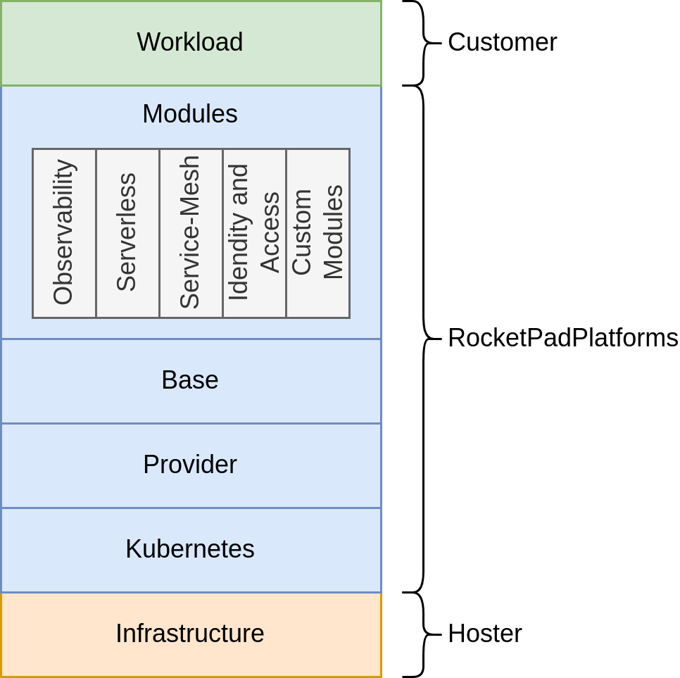

  

  # Rocket Pad Platforms

  Private cloud platform engineering — Kubernetes, GitOps, IaC, observability, security.

  
  

---

## Who we are

Rocket Pad Platforms is a platform engineering team building private cloud
infrastructure that companies actually own. We help organizations that care about
data sovereignty, vendor independence, and IT security — from education and healthcare
to the public sector and growing SMEs — get a production-ready Kubernetes platform
without spending months integrating it themselves. Less time wiring tools together,
more time shipping.

## Architecture

Every platform we run is built as a stack of layers, split by who owns what:

- **Workload** — the customer's applications, deployed on top of the platform.
- **Modules** — optional building blocks (observability, serverless, service mesh, identity & access, custom modules) composed as needed.
- **Base** — the mandatory foundation layer every cluster gets before any workload is deployed on it.
  Its purpose is to turn a bare Kubernetes cluster into one that's actually ready for
  application delivery, without every project having to hand-roll and integrate the same
  set of platform tools from scratch.

  It contains a pre-configured, pre-integrated set of components covering:
  - **GitOps** for declarative, auditable deployments
  - **Identity & access management** so every tool shares a single login and RBAC source
  - **Observability** for metrics, logs, and dashboards out of the box
  - **Ingress & TLS** so services are reachable and certificates renew themselves
  - **Secrets handling** for safely storing and syncing sensitive configuration

  This solves the recurring problem of every cluster/customer needing the same baseline
  stack wired together correctly (auth, ingress, TLS, GitOps, observability) before any
  real work can start — instead it's delivered as one coherent, versioned layer that's
  the same everywhere we deploy it.
- **Provider** — glue components required by a specific infrastructure provider (storage classes, load balancers).
- **Kubernetes** — the cluster itself, usually provisioned via Terraform.
- **Infrastructure** — bare servers, owned by whichever hoster/cloud runs them.

We own and maintain everything from Modules down to Kubernetes; customers own their Workload; hosters own the Infrastructure underneath.
